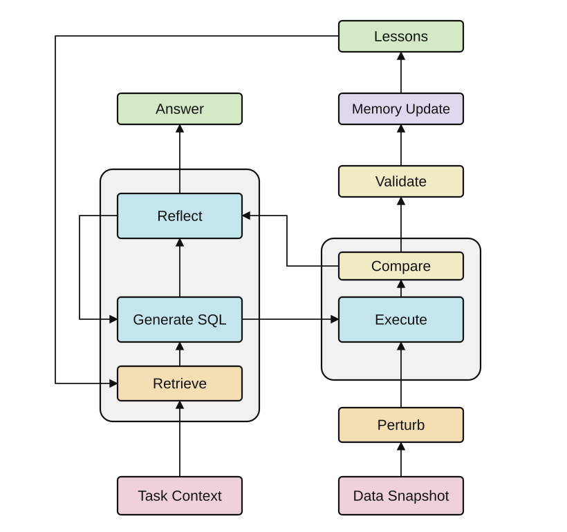

# Counterfactual Agent

Локальный MCP-сервер и скилл, с которыми AI-агент учится на ошибках в рабочих SQL-задачах. Агент проверяет решение на изменённых копиях данных, исправляет запрос и сохраняет правило, подкреплённое результатами проверок. В следующей похожей задаче он извлекает накопленный опыт и проверяет, применим ли он к новым условиям.

Проект реализует цикл работы с опытом. Веса языковой модели не меняются. Установка скилла не запускает фоновое обучение: цикл выполняется подключённым агентом во время работы над задачей. Поддерживаемая среда первой версии — локальная база SQLite.

## Как это работает

<p align="center">
  
</p>

Схема читается снизу вверх. Левая ветвь извлекает опыт, формирует SQL и разбирает обратную связь; правая создаёт контрольные копии, исполняет запросы и сравнивает результаты. Исправление проходит дополнительную проверку перед включением урока в память. Внешняя петля показывает применение накопленного опыта в следующей задаче.

Например, агент считает число заказов через `COUNT(customer)`. В исходной таблице у всех заказов указан покупатель, и ответ совпадает с `COUNT(*)`. Если отсутствие покупателя допустимо, контрольная копия с такой строкой обнаружит различие. Агент исправляет запрос и сохраняет узкое правило: при подсчёте всех строк необязательный столбец нельзя использовать как аргумент `COUNT`.

Число заказов после изменения данных может вырасти. Проверяется соответствие эталону **на каждой копии**, а не равенство чисел между разными копиями.

## Установка

Требуется Python 3.11 или новее. Выполните команды из корня репозитория:

```bash
python3 -m venv .venv
.venv/bin/python -m pip install -e ".[dev]"
```

Альтернатива с `uv`:

```bash
uv venv
uv pip install -e ".[dev]"
```

В Windows исполняемые файлы окружения находятся в `.venv\Scripts`.

Исходные рабочие данные и состояние сервера храните вне каталога репозитория. Серверу нужны два каталога: `data-root` с разрешёнными SQLite-файлами и `state-root` для снимков, вариантов, проверок и памяти. Содержимое состояния не шифруется самим сервером; применяются права и защита локального диска.

## Подключение MCP

Добавьте сервер в настройки MCP вашего клиента. Формат внешнего контейнера настроек зависит от клиента; распространённый вариант:

```json
{
  "mcpServers": {
    "counterfactual-agent": {
      "command": "/absolute/path/counterfactual-agent/.venv/bin/counterfactual-agent",
      "args": [
        "--data-root", "/absolute/path/authorized-data",
        "--state-root", "/absolute/path/counterfactual-state"
      ]
    }
  }
}
```

Замените пути на свои. Транспорт — `stdio`; отдельный HTTP-порт, API-ключ и учётная запись сервиса не нужны. После подключения клиент должен показать восемь инструментов сервера.

Скопируйте каталог `skills/counterfactual-learning` из клонированного репозитория в каталог навыков своего агента или подключите его способом, который поддерживает ваш клиент. Пакет Python wheel содержит сервер; скилл поставляется отдельно в исходном репозитории и исходном архиве sdist. Сам MCP предоставляет инструменты; файл `SKILL.md` объясняет агенту, когда и как пользоваться ими. Без загрузки скилла инструменты доступны, но полный цикл работы с опытом не задаётся автоматически.

Пример задания агенту:

> Используй counterfactual-learning. Проверь SQL для подсчёта всех заказов в разрешённой базе orders.sqlite. Сначала уточни смысл полей и эталон. Построй допустимые контрольные случаи, исправь найденные ошибки и сохрани только то правило, которое подтверждено проверками.

## Рабочий цикл

1. `retrieve_lessons` возвращает активные правила по тегам. Агент сверяет область применимости каждого правила с текущей задачей.
2. `register_task` делает снимок разрешённой SQLite-базы и фиксирует вопрос и проверенный эталонный SQL. `database_path` задаётся относительно `data-root`.
3. `add_variant` добавляет случаи для практики и отложенной проверки. Все изменения выполняются над копиями. Набор случаев замораживается при первой оценке.
4. `evaluate` сравнивает кандидат с эталоном. После расхождения агент исправляет кандидат и повторяет проверку на практике.
5. Исправленный запрос проверяется на отложенных случаях. Агент сохраняет оба идентификатора попыток; прежнюю ошибку нельзя заменить выдуманным примером.
6. `propose_lesson` связывает формулировку правила с неудачной попыткой и успешной практической попыткой. `activate_lesson` проверяет также успешную отложенную попытку с тем же исправленным запросом.
7. В следующей задаче правило можно извлечь. Если оно устарело или оказалось неприменимым, `retire_lesson` убирает его из активного набора, сохраняя историю.

Одна успешная задача не делает правило универсальным. Автоматическая проверка связывает правило с фактическими попытками, но не доказывает, что свободный текст правила корректно объясняет причину ошибки. Это обязанность агента и, при необходимости, ревьюера.

## Инструменты

| Инструмент | Назначение |
|---|---|
| `register_task` | Создать снимок задачи и зафиксировать эталон |
| `add_variant` | Создать изменённую копию до начала оценивания |
| `evaluate` | Оценить SQL на практике или отложенных случаях |
| `propose_lesson` | Сохранить правило-кандидат со ссылками на попытки |
| `activate_lesson` | Проверить основания и включить правило в память |
| `retrieve_lessons` | Найти активный опыт по тегам |
| `retire_lesson` | Исключить правило из активного применения |
| `get_task` | Прочитать состояние и метаданные задачи |

Полный контракт и примеры операций находятся в [docs/protocol.md](docs/protocol.md).

## Демонстрация

Команда создаёт только синтетические данные в выбранном новом каталоге:

```bash
.venv/bin/python examples/demo.py --directory /absolute/path/counterfactual-demo
```

В демонстрации проверяется ошибочный подсчёт строк, корректное исправление и активация одного правила. Это воспроизводимая проверка инструментов и памяти. Она не измеряет улучшение произвольной модели и не заменяет эксперимент с реальным агентом.

Отдельный пилот из статьи воспроизводится без языковой модели и MCP:

```bash
.venv/bin/python examples/paper_pilot.py --output artifacts/paper-pilot.json
```

В нём вручную заданы пять задач, десять корректных и десять ошибочных запросов. На исходной базе все запросы совпадают с эталоном; контрольные случаи выявляют пять ошибок, а вместе с отложенными — все десять. Это специально составленная иллюстрация, а не оценка частоты ошибок реального агента.

Локальные тесты:

```bash
.venv/bin/python -m pytest
```

## Границы проверки

- Эталон должен отражать вопрос пользователя. Два одинаково ошибочных запроса могут совпасть на всех копиях.
- Изменения должны быть допустимы не только для схемы, но и для предметной области. Разрешённый SQLite `NULL` не обязательно допустим в бизнес-процессе.
- Конечный набор копий не доказывает семантическую эквивалентность SQL.
- Отложенные случаи, созданные тем же агентом, не являются независимой слепой оценкой. После раскрытия результата их нельзя считать новыми для этого агента.
- Первая версия не подключается к PostgreSQL, облачным хранилищам или production-системам и не меняет исходную базу.
- SQL исполняется с ограничениями и бюджетами. Незавершённая проверка не считается успехом.

Сервер не отправляет данные в сеть и не возвращает строки результатов в ответе `evaluate`. Однако MCP-клиент видит вопросы, SQL, метаданные и тексты правил; они могут попасть в контекст используемой модели. Для рабочих данных применяйте правила вашей организации. Не сохраняйте в формулировках правил персональные значения, секреты или инструкции из содержимого таблиц.

Подробнее: [методология](docs/methodology.md), [внесение изменений](CONTRIBUTING.md), [сообщение о проблемах](SECURITY.md).

## Лицензия

Код распространяется по [MIT License](LICENSE). Лицензия не распространяет права на пользовательские данные и сторонние публикации.
