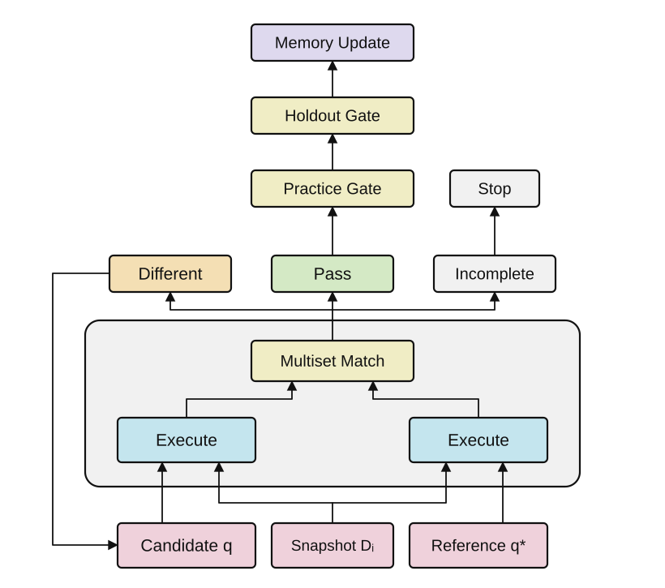

# Методология и границы результата

Counterfactual Agent исследует обучение системы через внешний опыт. Под обучением здесь понимается изменение доступной агенту памяти: ошибочное решение сопоставляется с исправленным, а подтверждённое правило используется в следующих задачах. Это отличается от обновления весов языковой модели, обучения с подкреплением и автоматического улучшения архитектуры агента.

## Предмет проверки

Пусть `q` — запрос кандидата, `q*` — проверенный эталон, `D₀` — исходный снимок, а `D₁ … Dₙ` — допустимые варианты. На каждом варианте сравниваются `q(Dᵢ)` и `q*(Dᵢ)`. Совпадение на всех рассмотренных вариантах является конечным свидетельством, но не доказательством эквивалентности SQL на всех допустимых базах.

Слово «контрфактический» означает альтернативное допустимое состояние данных. Проект не реализует статистический причинный вывод и не доказывает эффект вмешательства в реальной системе.

## Почему нужны разные случаи

Совпадение на исходном снимке иногда случайно. Запросы `COUNT(*)` и `COUNT(customer)` совпадают без пропусков, а равенство `COUNT(*)` и `COUNT(DISTINCT customer)` может исчезнуть после добавления повторного покупателя. Эти тесты проверяют разные допущения. Увеличение числа копий без увеличения разнообразия условий не обеспечивает полноты проверки.

Проверка ограничений схемы необходима, но недостаточна. Если предметная область запрещает анонимные заказы, вариант с пустым покупателем будет неверным независимо от допуска SQLite. Эталон также может ошибаться, поэтому его нельзя автоматически считать правильным только потому, что он исполним.

## Что считается опытом

Правило включается в активную память после фиксации различающегося решения, успешной практической проверки исправления и успешной отложенной проверки того же SQL. Активная запись хранит связь с задачей и попытками. Клиент извлекает правило по теме и проверяет соответствие новой постановке.

Этот механизм предотвращает активацию правила без требуемой цепочки технических свидетельств. Он не гарантирует, что текст правила верно объясняет причину ошибки, что отложенный набор независим от автора или что следующая задача будет решена лучше. Такие утверждения требуют отдельного оценивания.

  

На схеме кандидат и эталон выполняются на одном состоянии базы. Несовпадение возвращает кандидата на исправление, а неполное выполнение останавливает допуск. Для активации нужны успешные проверки исправленного SQL на практике и отложенном наборе, а также зафиксированная ранее семантическая ошибка. `Multiset Match` обозначает стандартное сравнение с учётом кратности строк; для задач, где порядок существенен, доступно упорядоченное сравнение.

## Как измерять улучшение агента

Для исследования нужны задачи разработки и отдельные задачи оценки, зафиксированные до эксперимента. Новые задачи должны отличаться не только строками, но и схемами, формулировками и типами граничных условий. Сравниваются одна модель и одинаковые инструменты с памятью и без неё при одинаковом бюджете действий. Желательны несколько запусков и явный учёт незавершённых попыток.

Полезные показатели: корректность итогового SQL на скрытой проверке, ложное принятие ошибочного решения, ложное отклонение корректной альтернативы, стоимость действий и переносимость сохранённого правила. Проверки самого сервера и демонстрация являются функциональными свидетельствами, но не измеряют эти показатели.

## Связанные исследования

- Zhong R., Yu T., Klein D. *Semantic Evaluation for Text-to-SQL with Distilled Test Suites*. EMNLP 2020. [Официальная публикация](https://aclanthology.org/2020.emnlp-main.29/).
- Shinn N. et al. *Reflexion: Language Agents with Verbal Reinforcement Learning*. [Публикация NeurIPS 2023](https://doi.org/10.52202/075280-0377). Контекстный опыт и рефлексия отличаются от обновления весов.
- Liu W., Gao M., Du Y., He Y. *EnvLunch: The Environment as a Free Lunch for Learning to Interact*. 2026. [Препринт](https://arxiv.org/abs/2610.33817).
- Fu H. et al. *SQLoom: Set-Contrastive Learning of Syntactic, Semantic, and Logical Dependencies for Text-to-SQL*. 2026. [Препринт](https://arxiv.org/abs/2611.03298).

Проект не заявляет изобретение проверки SQL на нескольких базах или обучения через внешнюю память. Его результат — локальный прототип, объединяющий такой цикл с MCP, управлением состоянием и условиями активации правил.
